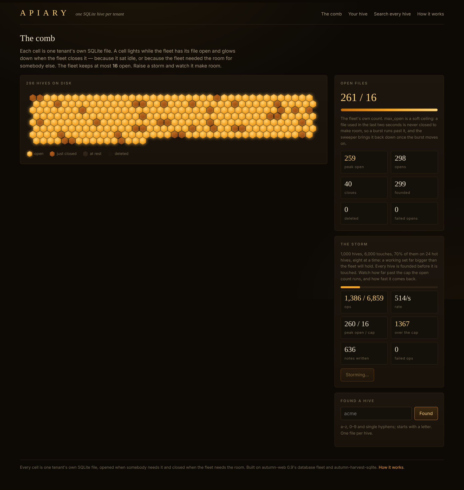
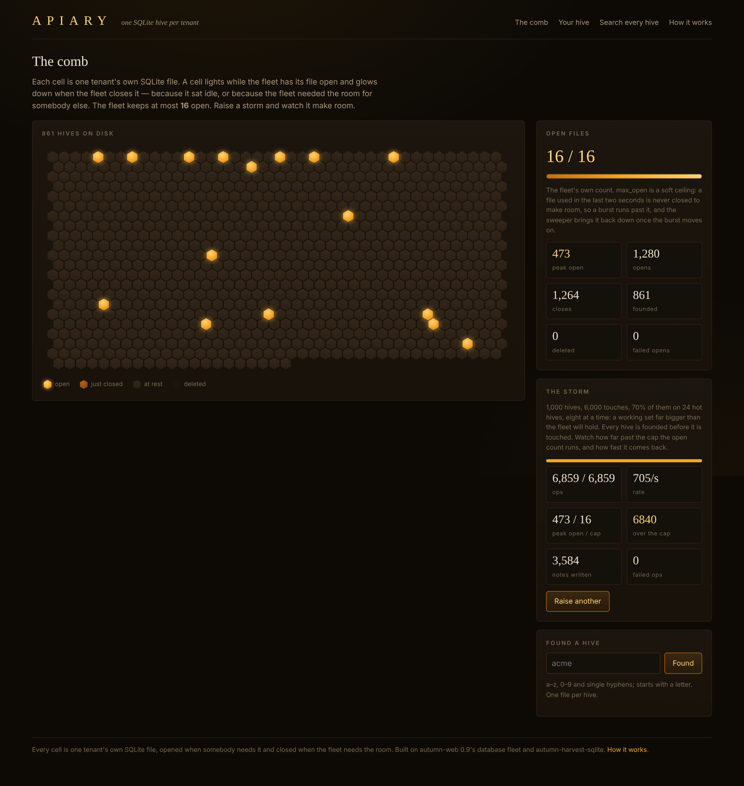
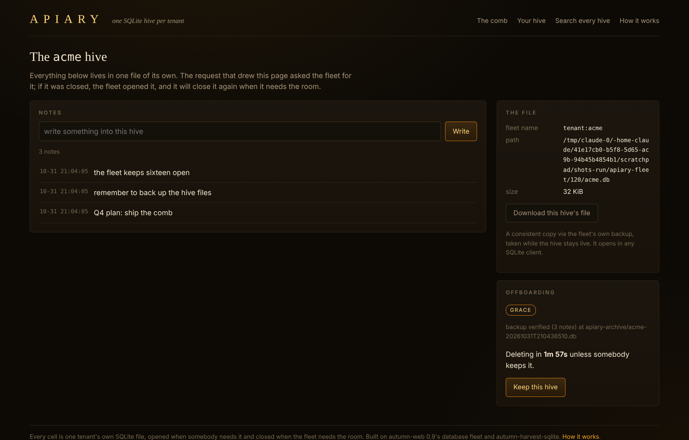
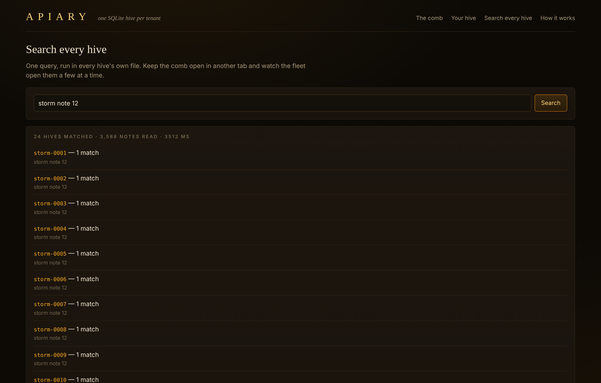
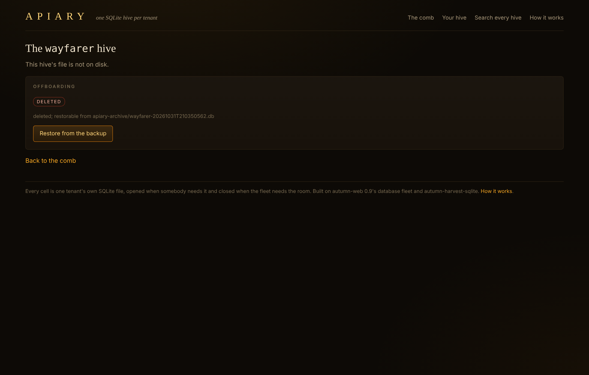

# Apiary

**One SQLite hive per tenant, and a window onto the fleet.** A test bed for
autumn-web 0.9's database fleet: every tenant is its own SQLite file, opened
and migrated on first use, closed when idle or when the fleet needs the room —
and a live honeycomb that shows you which files are open right now.

```sh
cargo run -p apiary-app      # then open http://localhost:3000
./verify.sh                  # the authoritative gate (toolchain, tests, boot, flow, Verus)
```

No database server, no Docker needed locally. The control database, every hive and the
workflow runtime are SQLite files beside the repo.



## What works today

- **The comb** — one hexagonal cell per hive file. A lifecycle hook on the
  fleet reports every open and close; the map is pushed over SSE at most four
  times a second. Lit = open, ember = just closed, dark = at rest, ghost =
  deleted. The gauge reads the fleet's own counters.
- **Found a hive** — explicit provisioning (`create_on_demand = false`). An
  unfounded hive is a `404`; a name that cannot name a file is a `400`, and
  neither creates anything.
- **Your hive** — notes through an ordinary generated repository,
  `#[repository(Note, tenant_scoped, sharded)]`, landing in that hive's own
  file. Download the file (a consistent copy via the fleet's backup, opens in
  any SQLite client).
- **The storm** — 1,000 hives, 6,000 touches, 70% on a hot set of 24, eight
  workers. Every hive is founded before it is touched — proved in Verus.
- **Search every hive** — the same repository over every file with
  `CrossShard`; with the comb open in another tab, you watch the sweep.
- **Offboarding** — a durable workflow on `autumn-harvest-sqlite`: back up,
  check the backup on its own, wait out a grace period anyone can cut short
  with **Keep**, then delete. Every outcome goes through one state machine,
  proved in Verus: a file is deleted only after a verified backup, an elapsed
  grace, and no keep.
- **Restore** — a deleted hive's ghost cell still walks in, and **Restore from
  the backup** puts the file back through the fleet's own lifecycle hook, which
  identity-checks and migrates it like any other.

| | |
|---|---|
|  |  |
|  |  |

## What the storm found

`max_open` is a **soft ceiling under bursts**. A config-built fleet never
closes a file used in the last two seconds, so the default storm peaks around
**440–600 open files against `max_open = 16`**, then the sweeper brings it back
to 16 within seconds and to 0 after `idle_close_secs`. Nothing leaks, but on a
Mac with the default `ulimit -n` of 256 the storm button can hit "too many open
files" — `verify.sh` raises the limit before booting. Details, and other
notes for the 0.9 docs, in [docs/FINDINGS.md](docs/FINDINGS.md).

## Deploy to Fly.io

One machine and one volume: `Dockerfile` builds the binary, `autumn-prod.toml`
is the prod profile (binds `0.0.0.0`, JSON logs, migrates on boot), and
`fly.toml` mounts every file Apiary writes at `/data`. Pick an app name first
and put it in `fly.toml` twice (`app` and `AUTUMN_SECURITY__TRUSTED_HOSTS__HOSTS`).

```sh
fly apps create <name>
fly volumes create apiary_data --region iad --size 1 --count 1 -a <name>
fly secrets set AUTUMN_SECURITY__SIGNING_SECRET="$(openssl rand -hex 32)" -a <name>
fly deploy --ha=false
```

`--ha=false` matters: Apiary is single-machine by construction (in-memory
sessions, one Harvest runtime, SQLite on one volume), so never scale past one.
To check the image locally first:

```sh
docker build -t apiary .
docker run --rm -p 3000:3000 -v apiary-data:/data \
  -e AUTUMN_SECURITY__SIGNING_SECRET="$(openssl rand -hex 32)" \
  -e AUTUMN_SECURITY__TRUSTED_HOSTS__HOSTS=localhost apiary
```

## Layout

```
crates/hive        the engine: hive names, the offboarding state machine,
                   the storm plan, the fleet map. No IO, no async, no clock.
crates/apiary-app  HTTP, the fleet, the control database, the Harvest runtime.
verus/src          offboard.rs (no unsafe delete), storm.rs (provision first)
docs/SPEC.md       what is formally and observably true, and a proof scoreboard
docs/adr           0001 one file per hive · 0002 one migration set
```

Settings beyond `autumn.toml` (which refuses unknown keys) are environment
variables — see `.env.example`.

## Verification

`./verify.sh` is the gate that counts: it pins the toolchain, runs fmt, clippy
(pedantic + nursery, `-D warnings`), every test, boots the binary in a scratch
directory and drives the whole flow over HTTP with a cookie jar (found → write
→ export → storm → search → offboard → delete → restore), runs
`autumn routes audit` if the CLI is installed, then Verus over both proofs.

Cloud pre-check on 2026-10-31: everything except Verus passed, including `autumn routes audit` (64 routes, 0 unclassified — the tenant pages are deliberately `#[public]` because there is no login) — 71 tests (33
engine unit + property, 26 app unit, 9 HTTP integration, 2 property tests
against the real fleet at 2,000 cases each, 1 end-to-end offboarding). **The
Verus has never been run**; `docs/SPEC.md` §7 ranks the obligations by how
likely each is to need another pass.

## Where this could go

- **No login.** The session holds which hive you are standing in, and anyone
  can walk into any hive. Real use needs auth with a hive membership check.
- **Slot mode.** The same repository runs unchanged with `mode = "slot"`; a
  comb of 8,192 slot cells would show many tenants sharing a file.
- **Two hosts.** `[database.fleet.ownership]` with replication: the comb
  colouring cells by owner, a fresh volume restoring on first touch.
- **A paced storm** slow enough to watch the LRU close one cell at a time while
  the cap holds.
- **Backup retention.** Archived backups are kept forever; a sweep could age
  them out after a restore window.
- **One migration set** puts an empty `offboardings` table in every hive (ADR
  0002) until autumn-web can scope app migration sets.
